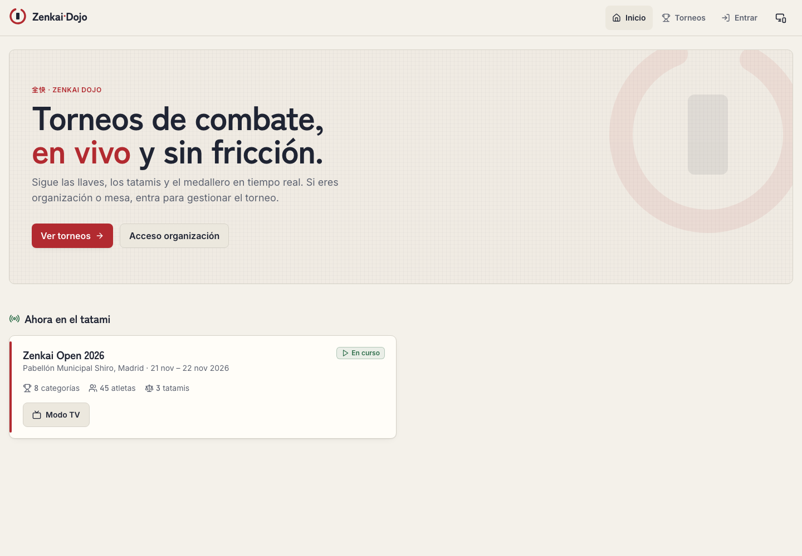
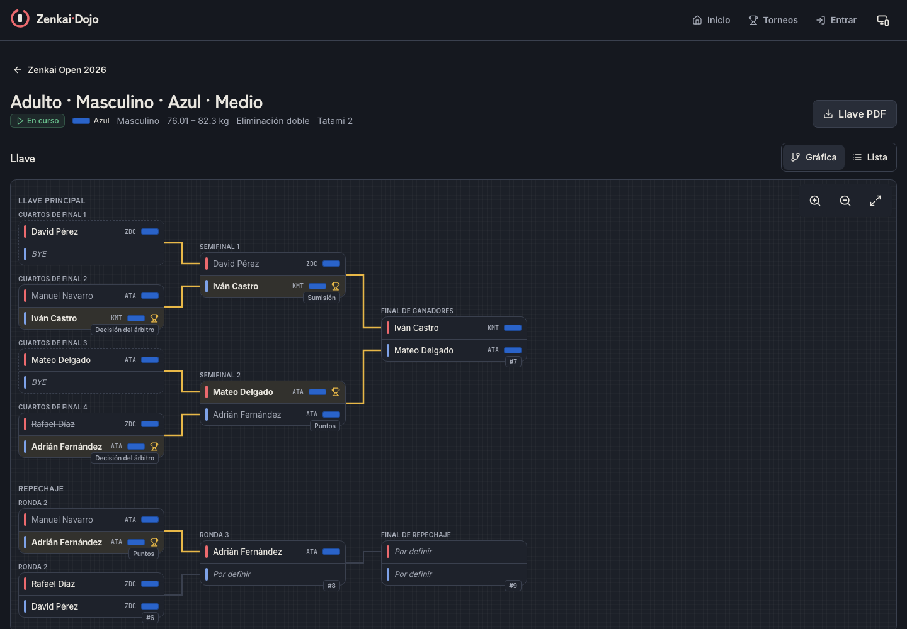
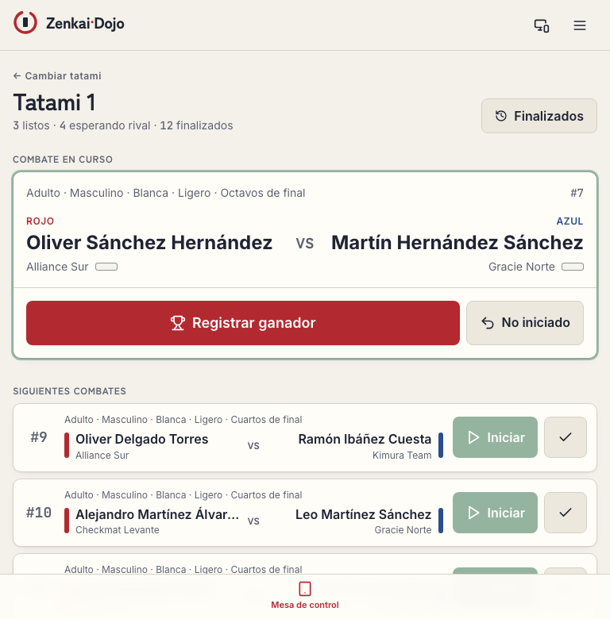
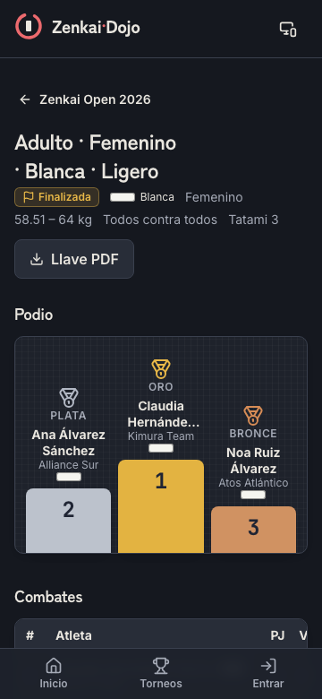
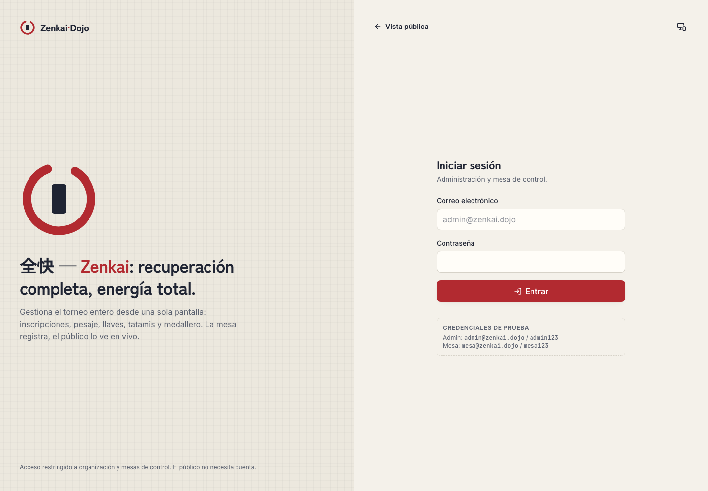
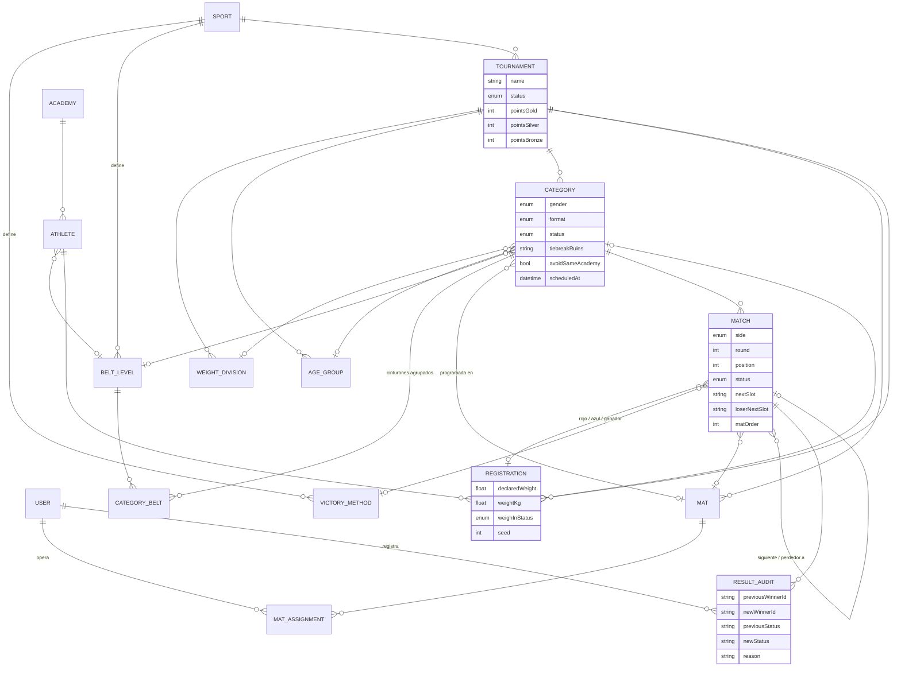

# Zenkai Dojo 全快

Sistema web para gestionar **torneos de deportes de combate**: deportes configurables, categorías, inscripciones, pesaje, llaves, tatamis, mesa de control, medallero y vista pública en vivo. Viene con **Jiu-Jitsu Brasileño** precargado y funciona en teléfono, tablet, PC y TV.

| Inicio (claro) | Llave de eliminación doble (oscuro) |
|---|---|
|  |  |

| Mesa de control (tablet) | Podio (móvil) | Pesaje (PC) |
|---|---|---|
|  |  |  |

---

> **Manual de usuario:** [`docs/Manual_de_usuario_Zenkai_Dojo.pdf`](docs/Manual_de_usuario_Zenkai_Dojo.pdf) explica con capturas cómo usar la aplicación (público, administración y mesa de control).

## Índice

1. [Inicio rápido](#1-inicio-rápido)
2. [Credenciales de prueba](#2-credenciales-de-prueba)
3. [Desarrollo local](#3-desarrollo-local)
4. [Arquitectura](#4-arquitectura)
5. [Modelo de datos](#5-modelo-de-datos)
6. [Cómo usar cada rol](#6-cómo-usar-cada-rol)
7. [Dirección de diseño](#7-dirección-de-diseño)
8. [Decisiones de diseño](#8-decisiones-de-diseño)
9. [Pruebas y verificación](#9-pruebas-y-verificación)
10. [Estructura del proyecto](#10-estructura-del-proyecto)

---

## 1. Inicio rápido

Requisito: Docker con Compose v2.

```bash
docker compose up -d --build
```

| Servicio | URL |
|---|---|
| Aplicación web | http://localhost:8080 |
| API REST | http://localhost:8080/api (también http://localhost:4000/api) |
| Documentación OpenAPI / Swagger | http://localhost:8080/docs |

Al arrancar, el backend aplica las migraciones de Prisma y, **si la base de datos está vacía**, carga los datos de prueba. Los reinicios posteriores conservan los datos.

Variables opcionales: copia `.env.example` a `.env` en la raíz para cambiar contraseñas, `JWT_SECRET`, `CORS_ORIGIN`, puertos (`WEB_PORT`, `API_PORT`), las credenciales del seed (`SEED_ADMIN_EMAIL`, `SEED_ADMIN_PASSWORD`, `SEED_TABLE_PASSWORD`), ocultar Swagger (`DOCS_ENABLED=false`) o desactivar el seed (`SEED_ON_START=false`).

**Demo en internet (gratis):** frontend y backend en Render y base de datos en Neon, con `render.yaml` en la raíz. Guía paso a paso en [`DEPLOY.md`](DEPLOY.md).

Para empezar de cero, con datos de prueba nuevos:

```bash
docker compose down -v && docker compose up -d --build
```

## 2. Credenciales de prueba

| Rol | Correo | Contraseña | Alcance |
|---|---|---|---|
| Administrador | `admin@zenkai.dojo` | `admin123` | Todo el sistema |
| Mesa de control | `mesa@zenkai.dojo` | `mesa123` | Tatami 1 |
| Mesa de control | `mesa2@zenkai.dojo` | `mesa123` | Tatamis 2 y 3 |

El público no necesita cuenta.

**Datos de ejemplo:** torneo *Zenkai Open 2026* en curso, 3 tatamis, 6 academias, 45 atletas y 8 categorías que cubren los cuatro formatos de llave. Hay categorías finalizadas con podio, otras en curso con un combate activo en el Tatami 1, otras sin llave, un atleta con sobrepeso pendiente de resolver y dos sin pesar. También se incluye Judo como segundo deporte, sin torneo.

## 3. Desarrollo local

Requisitos: Node 22 (el de Docker y Render; el backend lo fija con `engines`) y PostgreSQL ≥ 14.

```bash
# Backend
cd backend
npm install
cp .env.example .env          # ajusta DATABASE_URL y DIRECT_URL (en local, la misma cadena)
npx prisma migrate dev
npm run seed                  # ⚠️ borra y recarga todos los datos
npm run dev                   # http://localhost:4000 (docs en /docs)

# Frontend (otra terminal)
cd frontend
npm install
npm run dev                   # http://localhost:5173, con proxy /api → :4000
```

| Comando | Qué hace |
|---|---|
| `npm test` (backend) | 60 pruebas con Vitest |
| `npm run typecheck` | Comprobación de tipos (backend y frontend) |
| `npm run build` | Compilación de producción |

## 4. Arquitectura

```
┌──────────────┐   HTTPS    ┌──────────────────┐   /api    ┌──────────────────┐   SQL   ┌────────────┐
│  Navegador   │──────────▶ │  nginx (frontend)│─────────▶ │ Fastify + Prisma │───────▶ │ PostgreSQL │
│ React + Vite │ ◀──────────│  SPA estática    │ ◀──────── │  API REST + JWT  │ ◀────── │     16     │
└──────────────┘  polling   └──────────────────┘           └──────────────────┘         └────────────┘
```

| Capa | Tecnología |
|---|---|
| Backend | Node.js + TypeScript, **Fastify 5**, **Prisma 5**, Zod (`fastify-type-provider-zod`), `@fastify/jwt`, bcryptjs, pdfkit, exceljs |
| Frontend | **React 18 + Vite 5 + TypeScript**, Tailwind CSS 3, **Framer Motion**, React Router, TanStack Query, lucide-react, SheetJS (`xlsx`) |
| Infraestructura | docker-compose con PostgreSQL 16, backend Node 22 y nginx |

**Backend por módulos** (`backend/src/modules/*`). Cada módulo tiene sus rutas con esquemas Zod de entrada y salida. Esos esquemas validan las peticiones, tipan las respuestas y generan el OpenAPI. La lógica de torneo crítica está en **funciones puras** sin base de datos, que son las que cubren las pruebas:

| Archivo | Responsabilidad |
|---|---|
| `brackets/generator.ts` | Genera los 4 formatos, BYEs, siembra y evita la misma academia en primera ronda |
| `brackets/advance.ts` | Propaga ganadores y perdedores, e invalida en cascada al corregir |
| `brackets/standings.ts` | Tabla de round robin con desempates configurables |
| `brackets/podium.ts` | Podio según el formato |
| `registrations/weighin.ts` | Validación de peso y edad competitiva |
| `medals/calc.ts` | Medallero por academia con puntos configurables |

**Autorización:** cada endpoint declara su nivel: `requireRole('ADMIN')`, `authenticate` (cualquier usuario con sesión) o público. En cada petición con sesión se comprueba en la base de datos que el usuario sigue activo y cuál es su rol, así que desactivar a alguien surte efecto al instante. La mesa de control solo opera combates de los tatamis que tiene asignados y no accede a datos personales de los atletas.

**Errores:** formato uniforme `{ statusCode, code, message, details }` con mensajes en español. Los errores de Prisma se traducen: duplicado → 409, en uso → 409, no encontrado → 404.

**Tiempo real:** la vista pública consulta el servidor cada 5 s para llaves y tatamis, y cada 15 s para el medallero y las categorías.

## 5. Modelo de datos



Puntos clave:

- **Una categoría combina** género, grupo de edad, división de peso y cinturón. Los tres últimos son opcionales: si faltan, significa "cualquiera" o "absoluto".
- **El combate es un grafo.** `nextMatchId` y `nextSlot` indican dónde avanza el ganador. `loserNextId` y `loserNextSlot` indican dónde baja el perdedor, en el repechaje o en el combate por el bronce. Así, la propagación es igual para todos los formatos.
- **Los combates apuntan a inscripciones, no a atletas.** El mismo atleta puede competir en varios torneos con un peso y una siembra distintos en cada uno.
- **Auditoría:** cada registro o corrección de resultado guarda quién, cuándo, el valor anterior y el nuevo, y el motivo.

Migraciones en `backend/prisma/migrations`.

## 6. Cómo usar cada rol

### Administrador (`/admin`)

1. **Deportes:** define métodos de victoria, con puntos de desempate, la duración del combate y los cinturones con sus colores reales.
2. **Academias y atletas:** altas individuales o **importación Excel/CSV** con la plantilla descargable. Las cabeceras se reconocen en español; si se elige torneo, la importación inscribe y asigna categoría.
3. **Torneos → Nuevo torneo.** Dentro del torneo, cada pestaña sigue el orden real del evento:

| Pestaña | Para qué sirve |
|---|---|
| Configuración | Datos, estado, puntos del medallero, divisiones de peso y grupos de edad |
| Categorías | Alta manual o **generación asistida**, que combina edad × género × cinturón × peso. Elige el formato de llave por categoría |
| Inscripciones | Inscribir atletas, ver categorías compatibles, asignar automáticamente y fijar la siembra |
| Pesaje | Introduce el peso real. Si no cumple, propone categorías válidas o permite marcar como no apto |
| Llaves | Generar por sorteo o siembra, regenerar mientras no haya combates iniciados, registrar o corregir resultados y anularlos |
| Tatamis | Crear áreas, asignar usuarios de mesa y programar categorías con hora y orden |
| Auditoría | Historial completo de resultados |
| Exportar | PDF de llaves, participantes, horarios y resultados; Excel completo |

### Mesa de control (`/mesa`), pensada para tablet

1. Elige tu tatami. Solo aparecen los asignados.
2. La cola muestra los combates listos. Pulsa **Iniciar** para marcar el combate en curso.
3. **Registrar ganador:** una pulsación para la esquina y otra para el método de victoria. Se guarda al instante y el ganador avanza solo en la llave.
4. Para corregir, abre **Finalizados** y toca el combate. Es obligatorio indicar un motivo, y la corrección queda auditada. Los combates posteriores afectados vuelven a pendiente.

### Público (sin login)

- **Inicio y Torneos:** torneos publicados. Los que están en borrador no se muestran.
- **Torneo:** categorías con buscador y filtro por cinturón, **tatamis en vivo** y **medallero**.
- **Categoría:** en teléfono, la llave es un árbol vertical que cabe en la pantalla y se recorre con scroll normal. Desde 768 px es horizontal, se ajusta al ancho y admite zoom con Ctrl + rueda o pinza y arrastre. También hay vista en lista. Incluye el podio animado y la tabla de posiciones en round robin.
- **Modo TV** (`/t/:id/tv`): tipografía escalada a la pantalla, alterna tatamis y medallero cada 20 s y no requiere interacción.

## 7. Dirección de diseño

**Concepto: "Tatami & Obi".** El dojo como espacio sereno y ordenado, con acentos de color que marcan la acción, como el cinturón sobre el kimono.

| Elemento | Decisión |
|---|---|
| Paleta | **Shu** (bermellón) para acción y esquina roja. **Ai** (índigo) para esquina azul y enlaces. **Verde tatami** para "apto" y "en curso". Oro, plata y bronce para medallas |
| Fondo claro | Papel washi cálido `#f4f1ea`, menos agresivo que el blanco puro en sesiones largas |
| Fondo oscuro | Gris azulado profundo `#15181f`, nunca negro puro |
| Tipografía | **Zen Kaku Gothic New** en títulos, por su raíz japonesa. **Inter** en texto y **JetBrains Mono** en cifras tabulares (pesos, marcadores, posiciones) |
| Formas | Radio de 10 px. La **franja "obi"**, una banda vertical de color en las tarjetas, identifica tatami, academia o cinturón. Textura sutil de trama de tatami en fondos de llave y portada |
| Logo | Ensō (círculo zen) abierto en bermellón, con una barra central que evoca el cinturón |
| Iconografía | Lucide, trazo fino y consistente |
| Tono | Español claro y directo: "Registrar ganador", "Sin combate en curso" |

**Componentes propios:**

- **Llave:** columnas por ronda centradas sobre sus combates de origen. Los conectores SVG se dibujan en oro al resolverse cada combate. El combate en curso se resalta con un anillo verde. Admite zoom, desplazamiento y pinza.
- **Podio:** escalones que crecen en orden plata, oro y bronce, con medallas y academia.
- **Insignias de cinturón:** colores reales, con franja de punta para cinturones infantiles y negro.
- **Tablero de tatamis:** combate en curso, próximos tres y contadores de finalizados y pendientes.

**Movimiento.** Framer Motion con duraciones de 150–400 ms: entradas de página y listas escalonadas, combates que aparecen al cambiar de participante, conectores que avanzan, podio, indicador de pestaña y confirmación "Guardado". Con `prefers-reduced-motion` se desactivan mediante `MotionConfig reducedMotion="user"` y una regla CSS global. No hay animaciones infinitas ni destellos; solo los skeletons de carga pulsan.

**Accesibilidad.** Tokens de color con contraste AA en ambos temas. Ningún estado depende solo del color: el ganador lleva trofeo y negrita, el perdedor aparece tachado, las esquinas tienen etiqueta textual oculta "Rojo"/"Azul" y los estados llevan icono y texto. Hay enlace "Saltar al contenido", foco visible de 3 px, modales con `aria-modal` y cierre con Esc, tablas desplazables enfocables y zonas táctiles de 44 px como mínimo, de 52–112 px en la mesa. Las unidades son `rem`, así que el escalado del navegador funciona; base de 16 px.

## 8. Decisiones de diseño

Requisitos ambiguos resueltos así:

| Tema | Decisión |
|---|---|
| Edad competitiva | Año del torneo − año de nacimiento, convención IBJJF |
| Rangos de peso | Inclusivos en ambos extremos. Mínimo vacío significa "hasta X"; máximo vacío, "más de X" o absoluto. Una división puede limitarse a un género |
| Asignación automática | Solo cuando hay **exactamente una** categoría compatible. Si hay varias, la elección queda al admin, que ve las sugerencias |
| Atleta que no da el peso | Sigue inscrito con estado *Sobrepeso/Bajo peso* hasta que el admin lo mueve o lo marca *no apto*. Los no aptos quedan fuera de la llave. Los atletas sin pesar sí entran, con aviso, para no bloquear el torneo si se omite el pesaje |
| BYEs | Se asignan a las mejores siembras. Un combate participante-vs-vacío se muestra como **BYE** con avance automático. Si el rival vacío depende de otro combate, la ronda se colapsa y se recablea la llave |
| Eliminación simple | **Dos bronces**, los perdedores de semifinal, como en BJJ |
| Eliminación simple + bronce | Un bronce, para el ganador del combate por el 3.er lugar. Si un BYE en semifinales impide ese combate, el bronce es para el perdedor de la única semifinal real |
| Eliminación doble | Llave de ganadores + repechaje + **gran final única, sin reset**. Bronce para el perdedor de la final de repechaje. Los perdedores bajan cruzados para evitar revanchas tempranas |
| Round robin | Método del círculo. Desempates configurables por categoría (victorias → enfrentamiento directo → puntos por método → sorteo). El enfrentamiento directo se calcula **solo entre los empatados**, para evitar ciclos A>B>C>A. Los puntos por método se configuran por deporte; por ejemplo, en BJJ la sumisión vale 4 |
| Corrección de resultados | La mesa debe indicar un motivo; el admin no. Si cambia el ganador, los combates posteriores con resultado que pierden a su participante vuelven a pendiente, y esa invalidación también se audita |
| Regenerar llave | Solo sin combates iniciados ni finalizados. Con la llave generada, no se cambian los criterios ni los inscritos de la categoría |
| Iniciar combate | Opcional. La mesa puede registrar el resultado directamente; "Iniciar" sirve para mostrar el combate en curso al público |
| Cola por tatami | Se ordena por hora de la categoría, luego por orden de la categoría y luego por orden del combate. Se recalcula al generar llaves y al guardar la programación |
| Tiempo real | Polling en lugar de WebSocket: funciona detrás de cualquier proxy y es suficiente para el ritmo de un torneo |
| Público | Los torneos en *Borrador* no se exponen en ninguna ruta sin sesión: listado, llaves, tatamis, medallero ni PDF. Los PDF son públicos porque solo contienen datos que ya muestra la vista pública. El Excel completo incluye documento, correo y teléfono, así que **requiere sesión** |
| Importación Excel | Se procesa en el navegador con SheetJS, cargado bajo demanda, y se envía como JSON validado. Crea las academias que faltan y actualiza atletas por documento |
| Marcador y cronómetro | No se incluyen, por requisito. Solo se registra ganador y método. La duración se guarda por categoría como referencia |

## 9. Pruebas y verificación

### Pruebas automatizadas (backend)

```bash
cd backend && npm test      # 60 pruebas, todas en verde
```

| Archivo | Cubre |
|---|---|
| `generator.test.ts` | Los 4 formatos. Eliminación simple con 2–21 participantes jugada hasta el campeón, con BYEs, siembra manual, evitar misma academia y el caso imposible. Bronce con 3 y 8 atletas. Doble eliminación con 3–16 atletas, verificando que todos salvo el campeón pierden dos veces. Round robin con todos contra todos y sin repetir ronda |
| `advance.test.ts` | Avance al slot correcto, rechazo de ganador ajeno, corrección con invalidación en cascada, corrección solo de método sin invalidar, bajada al repechaje y BYEs encadenados |
| `weighin.test.ts` | Límites inclusivos, sobrepeso, bajo peso, absoluto y edad competitiva |
| `medals.test.ts` | Puntos configurables, desempate por oros y desempates de round robin |
| `env.test.ts` | Variables de producción: `JWT_SECRET` obligatorio, `CORS_ORIGIN` exacto (nunca `*`), `DOCS_ENABLED`/`TRUST_PROXY`, credenciales del seed obligatorias en producción |
| `http.test.ts` | Sin base de datos: `/health` y `/api/health`, cabeceras de helmet, CORS solo para el origen permitido, límite de 10 intentos de login (429 en español) y `/docs` desactivable |

### Pruebas de interfaz versionadas (Playwright)

`frontend/e2e` contiene 88 pruebas de regresión que escriben con pulsaciones reales, usan la rueda del ratón y emulan móviles:

| Archivo | Cubre |
|---|---|
| `modals-focus.spec.ts` | El foco no sale del campo al escribir en los modales de torneo, deporte, academia, usuario, atleta, categoría, inscripción y corrección de la mesa. También comprueba que Tab queda atrapado en el modal |
| `forms-validation.spec.ts` | Crear torneo y deporte con datos reales. Errores por campo en español con validación de cliente, sin llegar a enviar. Errores del servidor, como un nombre duplicado. Login |
| `bracket.spec.ts` | Llaves de 4, 6, 8, 13 y 16 atletas en 360, 390, 768, 1024 y 1440 px, en claro y oscuro: cabe sin desbordar, la rueda mueve la página y no la llave, Ctrl + rueda hace zoom, el arrastre está limitado, y "Ajustar a pantalla" y el doble clic reajustan |
| `navigation.spec.ts` | Navegar de una categoría al inicio con el logo (el caso que dejaba la pantalla en negro), atrás/adelante/F5 en rutas profundas, recorrido de las rutas públicas en móvil, tablet y escritorio en claro y oscuro, y el Error Boundary ("Algo salió mal"). Falla ante cualquier `pageerror`, `console.error` o respuesta 5xx |
| `app-tour.spec.ts` | Pantallas de admin y las 9 pestañas del torneo, acceso de la mesa, sesión (sin sesión, token inválido, cierre, usuario desactivado) y tiempo real: un combate iniciado desde la mesa aparece en la llave pública sin reiniciar el zoom |

```bash
cd frontend
npx playwright install chromium        # la primera vez
E2E_BASE_URL=http://localhost:8080 npm run test:e2e
```

### Flujo completo end-to-end

Verificado con Playwright sobre la interfaz real:

1. El admin crea un torneo y configura la división de peso y el grupo de edad.
2. Crea una categoría de eliminación simple con bronce, un tatami, asigna la mesa y programa la categoría.
3. Inscribe 6 atletas. En el pesaje, 5 son aptos y uno con sobrepeso se marca como no apto.
4. Genera la llave por sorteo: 5 atletas, con BYEs.
5. La cuenta de mesa inicia y registra los 5 combates con dos pulsaciones cada uno, y corrige un resultado con motivo.
6. La vista pública en móvil muestra el podio y el medallero con 3 academias. El admin ve la corrección en la auditoría.
7. Se descargan los 5 archivos de exportación (4 PDF y 1 Excel).

Resultado: sin errores de consola ni respuestas 5xx.

### Revisión responsive, temas y movimiento reducido

Se revisaron 16 pantallas (públicas, admin y mesa) en anchos de **360, 768, 1024, 1440 y 1920 px**, en modo **claro y oscuro** y con **`prefers-reduced-motion: reduce`**: 160 combinaciones, contra el build de producción servido por nginx en Docker. Se comprobó automáticamente que no hubiera desbordamiento horizontal ni errores de consola, y se revisaron capturas.

Problemas encontrados y corregidos:

- Cabecera del modo TV desbordada a 360 px.
- Etiqueta oculta de una tabla que escapaba de su contenedor de scroll.
- Etiquetas de ronda superpuestas en la llave.
- Nombres cortados en el podio móvil.
- Llave ilegible a 360 px: en teléfono ahora es un árbol vertical (sesión 4).

### Auditoría de accesibilidad

**axe-core 4** (`@axe-core/playwright`) con las reglas WCAG 2.0/2.1 A y AA, sobre las mismas 160 combinaciones:

| Ronda | Violaciones |
|---|---|
| Inicial | 4 tipos |
| Final | **0** |

Correcciones aplicadas tras la primera ronda:

- Contraste del oro y del ámbar en modo claro.
- Texto blanco sobre acentos claros en modo oscuro: ahora se usa el token `--c-on-accent`, que es tinta oscura en ese tema.
- Opacidad en combates BYE y en combates en espera de la mesa.
- Tablas desplazables sin foco de teclado.
- Nombre accesible de los combates de la llave, que ocultaba el texto visible.

No se ejecutó Lighthouse; axe cubre las mismas reglas de accesibilidad automatizables. Las pruebas automáticas no sustituyen una revisión manual con lector de pantalla.

## 10. Estructura del proyecto

```
Zenkai_Dojo/
├─ docker-compose.yml          db (postgres) + backend + frontend (nginx)
├─ render.yaml                 Blueprint de Render (demo gratuita: API + sitio estático)
├─ DEPLOY.md                   guía de despliegue en Render + Neon
├─ .env.example                variables de docker-compose
├─ MEMORIA.md                  notas de traspaso entre sesiones de trabajo
├─ docs/capturas/              capturas usadas en este README
├─ backend/
│  ├─ Dockerfile, docker-entrypoint.sh   migraciones + seed si está vacía + arranque
│  ├─ prisma/schema.prisma, migrations/, seed.ts, seed-if-empty.ts, seed-credentials.ts, demo-reset.ts
│  ├─ src/app.ts, server.ts    Fastify, Swagger, manejador de errores
│  ├─ src/plugins/auth.ts      JWT y control de roles
│  ├─ src/modules/             auth, users, sports, tournaments, categories, academies,
│  │                           athletes, registrations, brackets, matches, mats, medals,
│  │                           public, exports
│  └─ tests/                   Vitest
└─ frontend/
   ├─ Dockerfile, nginx.conf
   └─ src/
      ├─ index.css             tokens de color (claro/oscuro) y componentes base
      ├─ lib/                  API, auth, tema, movimiento, toasts, consultas
      ├─ components/           Bracket, MatchBox, Podium, MatBoard, MedalTable, ResultModal, ui/
      ├─ layouts/              PublicLayout, AppLayout (sidebar / barra inferior)
      └─ pages/                public/, admin/ (+ tournament/ con las pestañas), table/, LoginPage
```
